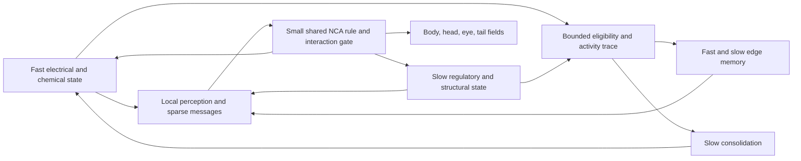

# BDH-NCA architecture

## Scope

The NCA provides a shared local developmental update. The BDH-inspired part provides history-dependent state on edges, temporary reinforcement, and slower consolidation. BraiNCA motivates selective local and sparse nonlocal messages. This is an original small synthesis, **not a reproduction of the BDH language model or the full BraiNCA GRU architecture**.

No external trajectory predictor, dense attention matrix, graph discovery algorithm, or biological unit calibration is required for this version.



## State and locality

At cell i, x_i has 24 channels, listed in `model.py:CHANNELS`. Channels 0-11 are fast observable/latent fields; 12-19 are slow regulatory, polarity, structural, adaptation, and latent fields. Channel 20 is an activity trace; 21 is a slower preference. Channels 22-23 identify the tissue domain and stay fixed on the initial scaffold. There is no continuously injected global coordinate grid or final anatomy map.

Four cardinal neighbors supply local messages. Two fixed horizontal links of length 6 supply longer-range messages. Thus incoming and outgoing degree are each at most 6. Boundary reads are zero; the grid never wraps. Long links carry an explicitly buffered message and voltage, adding one tick of delay beyond the synchronous source-state read. Endpoints must be alive, including the recorded sender. Links can cross an empty gap: they are abstract signaling shortcuts, not an explicit axon or diffusion simulation.

Each directed edge holds fast memory f_ij and slow memory s_ij. Structural connectivity is fixed; functional connectivity changes. There are no all-pairs scores or adaptive topology search. The local perception branch additionally senses immediate state, neighbor average, two directional derivatives, and a local Laplacian. Those fixed perception stencils are not gated by edge memory; learned messages and conductive voltage transport are gated.

## Selective messages

Bounded query/key/value projections give:

```text
score_ij = sigmoid(dot(tanh(Q x_i), tanh(K x_j)) / sqrt(8))
coupling_ij = 0.20 + 0.45 f_ij + 0.35 s_ij
w_ij = score_ij * coupling_ij * alive_i * alive_j * open_i * open_j
local_weight = w / max(1, sum_local w)
long_weight  = w / max(1, sum_long w)
local_message = sum_local local_weight * tanh(V x_j)
long_message = 0.10 * sum_long long_weight * delayed_value_j
```

Nonlocal value features are bounded in absolute magnitude by 0.10. Direct nonlocal voltage transport has coefficient 0.025 and voltage differences bounded by 2. This is an input-amplitude budget, **not a proof that the downstream neural response or distant causal influence is at most 10%**. Repeated signaling can accumulate. Do not interpret the horizontal topology as isotropic or rotation equivariant.

## Fast and slow update

A rank-4 cross-state feature is `tanh(A fast) * tanh(B slow)`. It lets regulatory and electrical evidence agree or oppose through learned signs. It is not an inferred probability or a calibrated energy.

The shared pointwise network takes 140 features, applies 96 ReLU units, and outputs 20 bounded increments. Observable anatomy has step scale 0.15, electrical/chemical fields 0.30, fast latent fields 0.20, and slow fields 0.015. A Bernoulli(0.5) cell mask applies updates asynchronously. These are dimensionless numerical rates, not fitted biological time constants. Slow rates are **per-tick step limits**, not guaranteed longer half-lives; learned dynamics determine actual relaxation.

Voltage also receives weak conductive transport, an external bounded current during intervention, and consolidated-preference recall attenuated by adaptation. A small decay acts on dynamic state. Occupancy and fate readouts remain in [0,1]; signed dynamic fields remain in [-1,1]. The nonnegative fate clamp uses a straight-through gradient during training so a negative update cannot permanently strand an absent fate at zero. Forward inference still uses the hard bound. This is a biased optimization estimator, not a biological process. The NCA pre/post liveness mask zeros cells without nearby viable tissue.

## Reinforcement, resource limits, and consolidation

For an edge, eligibility combines voltage agreement, regulatory agreement, receiver activity, and reduced adaptation:

```text
e = voltage_agreement * regulatory_agreement * abs(voltage_i) * (1-adaptation_i)
headroom = max(0, 1-f-s)
competition = 1 / (1 + sum_incoming f)
transfer = 0.003 f
f' = clip(f + 0.06 e * headroom * competition - 0.02 f - transfer, 0, 1)
s' = clip(s + transfer - 0.0005 s, 0, 1)
(f',s') /= max(1, f'+s')
```

Fast reinforcement spends finite headroom. Transfer removes the same amount from fast memory that is offered to slow memory. Competition limits simultaneous reinforcement; both memories decay. This is capacity accounting, not a metabolic energy or chemical mass conservation law. Edge updates happen every tick, while cell-state updates use the stochastic mask.

Within cells, a 0.04-rate trace averages voltage. A 0.003-rate preference integrates that trace only when electrical and regulatory state have matching signs. The preference recalls a weak voltage tendency (coefficient 0.015), while the learned slow update can use all local state, including the preference. This supplies the desired reciprocal fast/slow pathway without an unbounded Hebbian multiplier.

These bounds prevent numerical amplitude blowup, but do not guarantee a unique attractor, healthy morphology, useful memory, or freedom from oscillation. Long-run tests and ablations remain necessary. Decay prevents a perfect permanent lock; training may still yield over-stable behavior.

Deleting a cell clears its state, incident edge memories, and delayed packets involving that endpoint. Undamaged connections retain their history. The damage helper uses the same constrained offsets as message passing; deletion cannot leave a hidden packet that later resurrects deleted information.

## Parameter accounting

The three message projections use 600 parameters; the two rank-4 factors use 40. The main rule uses `161 * hidden + 20`. Total: `161 * hidden + 660`, giving 16,116 at width 96. Rates, offsets, state buffers, and plastic memories are not learned parameters.

## Intentional simplifications

- Grid cells represent tissue patches, not individual biophysical cells.
- Head, eyes, and tail are continuous identity fields on tissue; discrete anatomy is only a screening readout.
- No ion-channel kinetics, electrophysiological units, explicit mechanics, real genome sequence, force balance, cell division, or molecular pathways are modeled.
- The normal silhouette is supplied initially. New body contours, fully formed extra heads, and anatomical organs require stronger demonstrations than detecting field components.
- The generator includes ordinary developmental spatial priors. This cannot establish that real biological interventions follow the synthetic model's rules.
